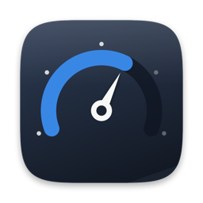
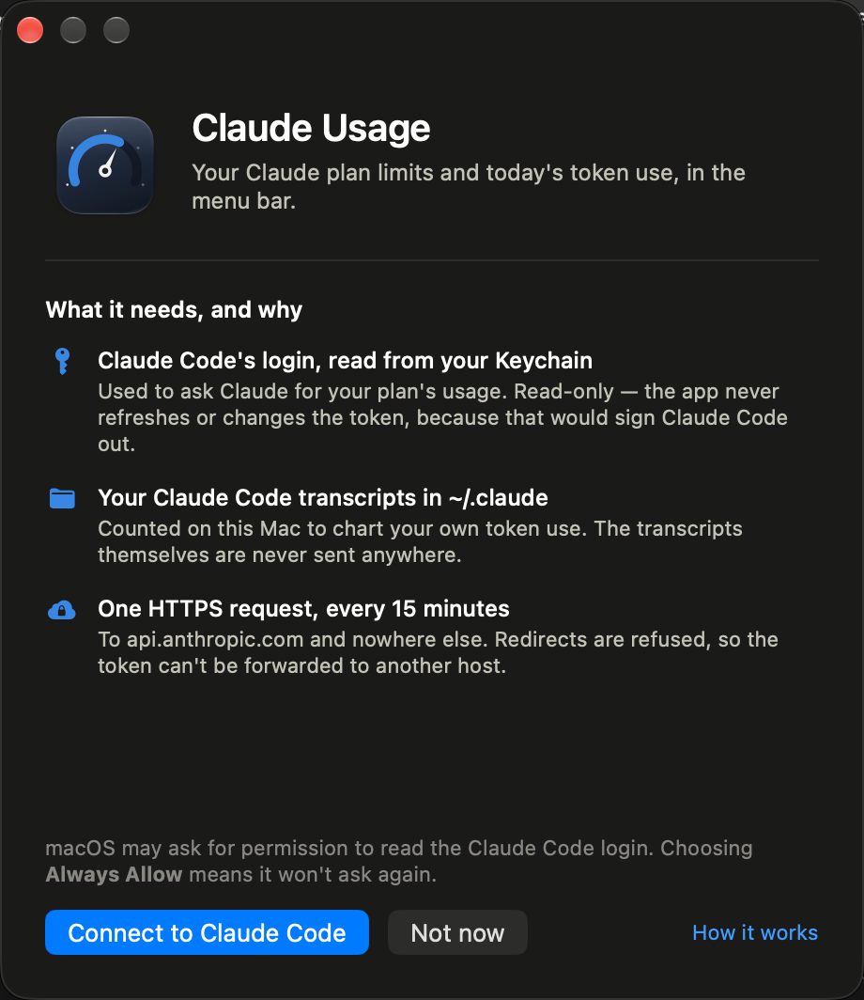
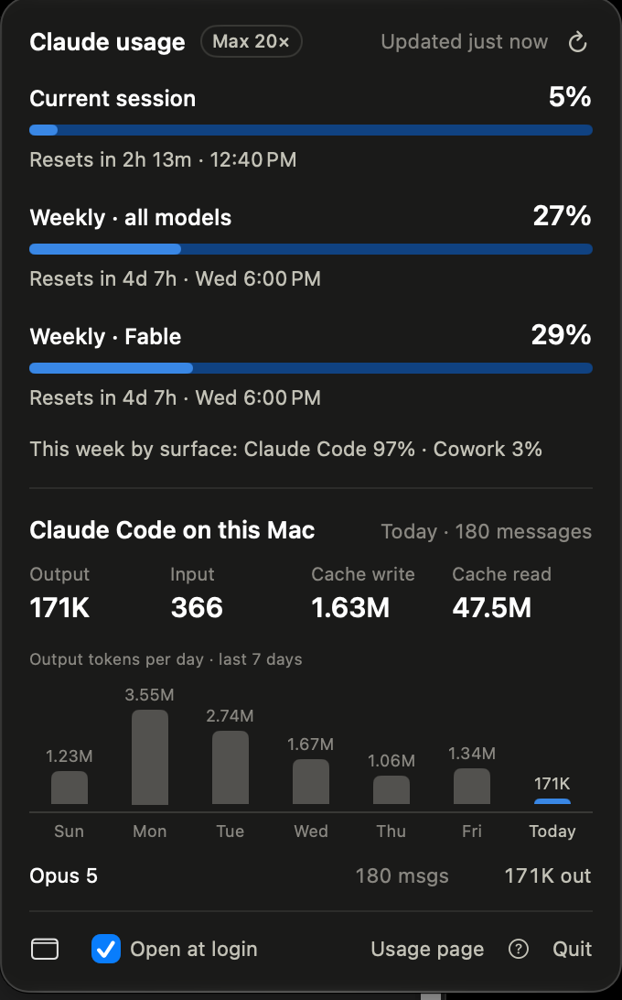

<div align="center">



# Claude Usage

**Your Claude plan limits, live in the macOS menu bar.**

The same numbers as Claude Code's `/usage`, plus the tokens Claude Code has recorded on this Mac.

[](https://github.com/chrisrmullinsdesign/usage/actions/workflows/build.yml)
[](LICENSE)


</div>

---

## Install

Build it — a few seconds, and no Xcode project needed:

```sh
git clone https://github.com/chrisrmullinsdesign/usage.git
cd usage
./build.sh --install
```

That produces a universal binary, signs it, and copies it to `~/Applications`. Open it and a
window explains what the app reads before it reads anything — click **Connect to Claude Code**.

You need the Xcode command line tools (`xcode-select --install`), macOS 14+, and
[Claude Code](https://claude.com/claude-code) installed and signed in — that's where the usage
data comes from.

> **No download yet.** A notarized DMG isn't published, so there's nothing to drag from a
> release page. Building from source sidesteps Gatekeeper entirely: a binary you compiled runs
> without any "unidentified developer" prompt. `Scripts/release.sh` is ready to produce a
> signed, notarized, stapled DMG whenever that changes.

<div align="center"></div>

## What it shows



**Plan limits** — from `GET https://api.anthropic.com/api/oauth/usage`

- Weekly all-models usage as the headline figure, with an even-pace tick and a projection of where you'll land at reset
- Weekly per-model limits (a session window is still shown if the API ever returns one)
- Reset countdowns, and this week's usage split by surface
- Meters turn amber and red, with an icon and a label, as the API reports higher severity —
  status never rides on colour alone

**Claude Code on this Mac** — from `~/.claude/projects/**/*.jsonl`

- Today's output, input, cache-write and cache-read tokens, and message count
- Output tokens per day for the last seven days; hover a column for that day's detail
- Today's usage by model

The menu bar shows the weekly % by default; the button in the popover footer switches it to
weekly % plus days until reset, or icon-only.

It refreshes every 15 minutes, when you open the popover and the figures are over five minutes
old, or when you click ↻.

<br clear="right">

## How it works

The interesting part of this project is what it *doesn't* do.

**It never touches your token beyond reading it.** Claude Code stores its OAuth login in the
Keychain. This app reads that item through `/usr/bin/security`, keeps only
`claudeAiOauth.accessToken` in memory, and discards the rest — the same item also holds Claude
Code's MCP secrets. It never refreshes or rewrites the token, because rotating it would sign
Claude Code out. If the token expires, the popover keeps the last figures and tells you to open
Claude Code, which renews it.

**One host, no redirects.** One HTTPS request per refresh, to `api.anthropic.com`. The URL
session is ephemeral — no disk cache, no cookies, TLS 1.2 minimum — and redirects are *refused*,
so the bearer token can't be forwarded somewhere else by a 302. Transcript data never leaves the Mac.

**Permission is asked for, not sprung.** Nothing reads the Keychain until you click Connect in
the first-run window. Each way that read can fail — no Claude Code login, a denied dialog, a
locked Keychain, a malformed item — gets its own message and its own next step, rather than one
generic error. If the Keychain route doesn't work at all, you can paste a token instead; it goes
into the app's own Keychain item and never touches Claude Code's. See
[SECURITY.md](SECURITY.md#pasted-tokens).

**It stays out of the way.** Transcripts are read incrementally: the first scan covers seven days
in about three seconds, and later scans only parse the bytes appended since the last one,
de-duplicated by API message id. Lines over 32 MB (pasted images, file dumps) are skipped instead
of buffered. The 15-minute timer carries 60 seconds of tolerance so macOS can coalesce the wake-up,
and HTTP 429 backs off for 30 minutes. Idle cost is about 60 MB of memory and no CPU to speak of.

**Hardened runtime, no entitlements, no dependencies.** AppKit, SwiftUI and Foundation only.
It isn't sandboxed — the App Sandbox would block reading `~/.claude` — which is exactly why the
source is kept short enough to read in a sitting. See [SECURITY.md](SECURITY.md).

## Build options

```sh
./build.sh            # build/ClaudeUsage.app, universal
./build.sh --install  # also copy to ~/Applications and launch
```

There's no Xcode project and no package manager: `build.sh` runs `swiftc` once per architecture
and `lipo`s the result. Without a signing certificate it signs ad-hoc, which is all a local
build needs; with a Developer ID certificate it uses that instead. `Scripts/release.sh` takes a
Developer ID build the rest of the way to a notarized, stapled DMG.

`Scripts/make-icon.sh` re-renders the app icon from `Scripts/make-icon.swift` — the icon is
drawn in CoreGraphics, not pasted in from a design tool.

## Uninstall

Untick **Open at login**, click **Quit**, then:

```sh
rm -rf /Applications/ClaudeUsage.app ~/Applications/ClaudeUsage.app
rm -f ~/Library/Logs/ClaudeUsage.log
defaults delete com.chrismullins.ClaudeUsage
```

(The DMG installs to `/Applications`; `./build.sh --install` puts a build in `~/Applications`.
Removing both covers either route.)

## Source map

| File | |
|---|---|
| `Sources/App.swift` | The `MenuBarExtra` scene and app delegate |
| `Sources/Usage.swift` | Keychain read, usage API model, polling store, log |
| `Sources/Transcripts.swift` | Incremental transcript scanner |
| `Sources/Views.swift` | Menu bar label, popover, meters, seven-day columns |
| `Sources/Welcome.swift` | First-run window and permission recovery |

About 1,300 lines of Swift.

## Notes

This is an unofficial personal project. It is not affiliated with, endorsed by, or supported by
Anthropic, and it calls an endpoint that Anthropic doesn't document — that endpoint can change
or disappear without notice. The app is written to fail visibly when it does.

MIT licensed. © 2026 Chris Mullins.
